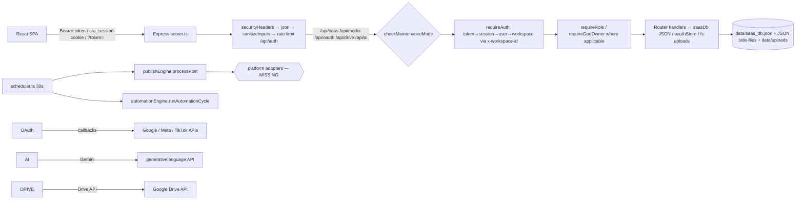

# 04 — Backend Architecture

## Components

| Module | File | Role |
|---|---|---|
| Bootstrap | `server.ts` | Express app, security headers, JSON limits (150mb), static `/uploads`, rate limiter on /api/auth, health endpoints, maintenance HTML page, mounts routers, starts scheduler |
| Auth | `server/authRouter.ts` (1,275 ln) | register/login/logout/me, email verify, password reset/change, profile, sessions, MFA, demo/social/magic/passkey/SSO logins; exports `requireAuth`, `requireRole`, `requireGodOwner`, `checkMaintenanceMode`, `extractToken` |
| DB | `server/saasDb.ts` (815 ln) | In-memory JSON DB: users, sessions, verificationTokens, workspaces, members, invitations, auditLogs, workspaceData{}, systemSettings. scrypt hashing, GOD-owner invariants, sanitizers |
| SaaS API | `server/saasRouter.ts` (2,130 ln) | ~86 endpoints: state sync, queue, history, brands, projects, workspace, members/invites/roles, subscription, admin/* (users, settings, announcements, sessions, audit, storage, security, infra, scheduler, privacy, maintenance, backups, tasks, recovery), account lifecycle, automations CRUD/exec/approvals/analytics, social-accounts scoping |
| OAuth | `server/oauthRouter.ts` (1,452 ln) + `oauthStore.ts` | Provider config (GOD-managed), authorize-url, callbacks for youtube/facebook/instagram/tiktok, accounts list/select/brand/refresh/diagnostics/delete. Tokens AES-256-CBC encrypted in `social_connections.json` |
| Drive | `server/driveRouter.ts` | Google Drive OAuth (PKCE, drive.readonly), connections, file browse/download, import jobs |
| Media | `server/mediaRouter.ts` + `uploadPolicy.ts` | base64 + chunked uploads, policy/quota/plan limits, magic-byte sniffing, catalog, delete |
| AI | `server/aiRouter.ts` (756 ln) | 6 Gemini endpoints via @google/genai (`gemini-3.8-flash`); requireAuth; 503 without key |
| Publishing | `server/publishEngine.ts` + `scheduler.ts` | 30s cycle: claim→events→platform attempt→verify→retry/backoff/dead-letter. **No platform adapters — always fails `adapter_missing`** |
| Automations | `server/automationEngine.ts` (458 ln) | Trigger eval + step executors run inside scheduler cycle; approvals in `automation_approvals.json` |
| Security | `server/security.ts`, `bruteForceGuard.ts` | Headers, null-byte sanitizer, in-memory sliding-window limiter, credential-stuffing guard (in-process) |

## Request flow

## Data flow notes

- **Workspace state sync:** frontend keeps entire workspace payload (brands, posts, videos, analytics, automations, calendar entities…) in memory+localStorage, pushes whole object via `POST /api/saas/state`; server merges shallowly (`{...current, ...data}`) into `workspaceData[workspaceId]`. **Lost-update risk**: concurrent tabs/users overwrite each other's arrays; no per-entity endpoints for posts/videos/analytics — everything funnels through one blob.
- **Auth context:** `x-workspace-id` header selects workspace; falls back to first membership — a user in multiple workspaces silently acts on workspace[0] if header absent.
- **Scheduler:** iterates ALL workspaces' posts every 30s; `isRunning` guard prevents overlap; stuck 'publishing' >10min recovered; per-workspace `queuePaused` and autopilot `emergencyPaused` honored.
- **Persistence:** every mutation → `saveDatabase()` → full JSON.stringify of ~7.8MB + atomic rename. O(n) write amplification; single process only (multi-instance would corrupt/lose data — file is per-host).

## Architectural assessment

- **Separation:** reasonable router/engine split; business logic mostly inside route handlers (fat controllers) — e.g., OAuth callback is ~600 lines inline.
- **Risk patterns:** global mutable `dbCache`; fire-and-forget `runAutomationCycle()`; no request timeouts on outbound fetch (platform calls could hang a cycle); `express.json 150mb` permits huge payloads; in-memory rate limit/brute-force/pending-attempt stores don't survive restart or scale horizontally.
- **Circular deps:** none observed; dynamic `import()` used to break cycles (automationEngine, scheduler).
