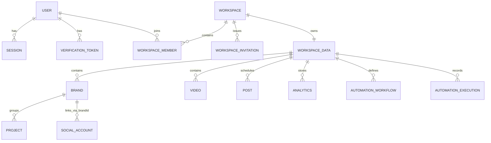

# 06 — Database Audit

## Engine
**None.** Persistence = JSON files under `data/`:

| Store | File | Contents |
|---|---|---|
| Primary DB | `data/saas_db.json` (~7.8 MB) | users, sessions, verificationTokens, workspaces, workspaceMembers, workspaceInvitations, auditLogs (cap 1000), workspaceData{wsId → payload}, systemSettings |
| OAuth accounts | `data/social_connections.json` | SocialAccountRecord[] (encrypted tokens, channels, permissions) |
| OAuth config | `data/oauth_config.json` | Provider credentials entered via GOD console (plaintext) |
| Media catalog | `data/media_catalog.json` | MediaAsset[] |
| Drive | `data/drive_connections.json`, `drive_imports.json` | Google Drive OAuth + import jobs |
| Automations | `data/automation_approvals.json` | Pending/resolved approvals |
| Upload policy | `data/upload_policy.json` | Policy (defaults if absent) |
| Upload sessions | `data/uploads/.sessions/*/meta.json` + chunks | Resumable upload state |
| Backups | `data/backups/*.json` + index.json | Manual file-copy backups (GOD-triggered) |
| Maintenance tasks | `data/maintenance_tasks.json` | Task history (last 200) |

Access pattern: `getDb()` returns a process-wide in-memory object; every mutation calls `saveDatabase()` → `JSON.stringify(entire DB)` → tmp file → `renameSync`. Atomic per-write, but O(DB size) per write and **single-process only**.

## Schema (saas_db.json)

- **users[]**: id, email (unique enforced in code), passwordHash, salt, fullName, avatarUrl, role (god|super_admin|platform_admin|admin|moderator|support|user), isEmailVerified, status, mfaEnabled/mfaSecret, timestamps, profile fields, pendingEmail, deactivation/deletion fields, preferences{}.
- **sessions[]**: id, userId→users, token (plaintext bearer), ip, userAgent, createdAt, expiresAt (30d).
- **verificationTokens[]**: id, userId (sometimes an EMAIL for magic links — type abuse), token, type, expiresAt, usedAt.
- **workspaces[]**: id, name, slug, ownerId, plan, billingCycle, settings{}.
- **workspaceMembers[]**: id, workspaceId, userId, role, status, customRoleId?, invitedBy, invitedEmail, joinedAt.
- **workspaceInvitations[]**: id, workspaceId, email, role, tokenHash(sha256), status, expiresAt.
- **auditLogs[]**: id, workspaceId?, userId?, userEmail, action, details, ip, timestamp — capped at 1000, `unshift` ordering.
- **workspaceData[wsId]**: free-form payload — brands[], activeBrandId, projects[], accounts[], categories[], videos[], analytics[], posts[], recommendations[], experiments[], autopilotConfig, auditLogs[], automationWorkflows[], automationExecutions[], customRoles[], campaigns[], contentPillars[], contentIdeas[], postComments[], calendarSavedViews[], calendarSettings{}, queuePaused. **No schema enforcement** — arbitrary client-supplied JSON is merged wholesale via POST /api/saas/state.
- **systemSettings**: maintenanceMode/Message, announcements[], featureFlags{}, security{}, primaryOwnerUserId, maintenanceConfig{}.

## ER (major relationships)

## Tenant isolation
- All tenant data lives under `workspaceData[workspaceId]`; `/api/saas/*` requires `req.workspace` resolved server-side from membership (not client-trusted).
- Social accounts scoped via `brandId ∈ workspace brands` (`getScopedSocialAccounts`, `accountInWorkspace`) — including legacy records without workspaceId.
- Brand-level: `canAccessBrand` rank checks; open brands (no members[]) visible to all workspace members.
- **Gaps:** `POST /api/saas/state` accepts arbitrary payload — a workspace member can inject posts referencing foreign brandIds/accounts (no referential validation on the blob). `PUT /workspace/:id` allows **any member** (not just owner) to change name/plan/settings — plan self-upgrade possible. `verificationTokens.userId` reused to store emails (magic links) — type confusion. Cross-tenant runtime test BLOCKED (no Node runtime).

## Integrity issues
- No FK/unique/index/constraint enforcement anywhere — all integrity is procedural.
- Orphans possible: deleting a brand leaves posts/videos referencing brandId (dependency check exists but `force=true` bypasses; brand delete doesn't cascade-clean).
- `deleteUser` removes owned workspaces but NOT invitations/audit references; social_connections for deleted users' brands are only cleaned in the self-service DELETE /account path.
- Avatar stored as base64 data-URL inside user record → unbounded growth of saas_db.json.
- 15 leaked `saas_db.json.tmp.*` files indicate rename failures under load.
- Status enums unvalidated in several PATCH paths (brand.status, post.status via state blob).
- Sessions store **raw tokens** (not hashed) — DB file leak = full account takeover.
- `mfaSecret` stored as `random:code` plaintext.

## Data persistence verification
- Writes are real (file-backed, atomic rename) — data survives restart.
- Frontend dual-writes localStorage + remote; on remote failure data still shows locally → **UI can display data that was never persisted** (silent divergence risk).
