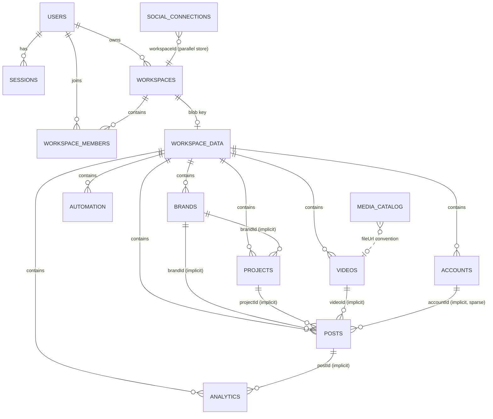

# 05 — Implicit Schema

Types live in `src/types/` (7 files, ~53 exported interfaces/types) [READ]; server has its own interfaces in `server/saasDb.ts` (User, UserSession, VerificationToken, Workspace, WorkspaceDataPayload…). The **de-facto schema is whatever JSON happens to be in the files** — no validation on read or write of `workspaceData` blob contents.

## Types vs actual data — key diffs [RUN data_inventory.json + READ types]

| Entity | In types? | In data? | Diff / conflict |
|---|---|---|---|
| `Brand.avatarUrl / logoUrl / coverImageUrl` | ✅ optional strings | ✅ present — **as multi-MB base64 data-URLs** | Type says `string` (URL implied); data holds `data:image/...;base64,...`. No size constraint anywhere. SEC-20 confirmed at 7.7 MB scale. |
| `SocialAccount` (types/social.ts) | ✅ rich shape: `brandId, platform, accountName, handle, isConnected, apiPermissions{…}, channels[]` | ⚠️ `workspaceData.accounts[]` records are **flatter** — actual fields observed: id, platform, brandId?, accountName/handle, status… The OAuth-store shape is `SocialConnectionAccount` (different interface, `provider`, `externalAccountId`, `channels[]`…) | **Two parallel account models**: blob `accounts[]` (UI-facing) vs `social_connections.json` (OAuth tokens). Fields don't map 1:1 — migration must reconcile. |
| `ScheduledPost` (content.ts) | ✅ `brandId, videoId, channelPlatforms[], scheduledTime, status, publishOperationId, publishingEvents[], retryCount, nextRetryAt, reviewStatus…` | ✅ posts carry these + extras (`platformPostId`, `postUrl`, `accountId` used by T1.0 ref-check but **not in the type**) | `post.accountId`, `post.platformPostId`, `post.postUrl`, `post.channelPlatforms` vs `platforms` alias used in migration script — field-name drift between writer (frontend) and reader (engine/migration). |
| `Workspace` (workspace.ts) | ✅ id,name,slug,ownerId,plan,billingCycle,settings | ✅ + runtime extras: `subscriptionStatus`?, `stateVersions` external | `plan` values observed within enum; `billingCycle` monthly only in data. |
| `WorkspaceMember` | ✅ role union includes 'manager','publisher','analyst' — **not in server `workspace_role` DDL enum** (owner/admin/editor/viewer) | data uses server roles | Role vocabularies diverge FE↔BE↔DDL — needs single enum decision (flag for 3.2). |
| `workspaceData` blob keys | ❌ no type covers the blob itself | 25 keys observed (brands…calendarSettings, queuePaused, videoFolders, automationRules/Logs, savedStrategy, aiVideoResults) | `WorkspaceDataPayload` (server) covers ~20; frontend pushes **5 extra keys** (videoFolders, automationRules, automationLogs, savedStrategy, aiVideoResults) not in the interface — tolerated by shallow merge, invisible to typecheck. |
| `VerificationToken.type` | server union: email_verification/password_reset/email_change/magic_link | 53 records, all valid types [RUN] | aligned post-T0.18 |
| `users[]` vs `User` | server User has passwordHash/salt (never serialized); client User sanitized | 5 users | salt+hash never leave server — good; `pendingEmail`, `preferences` jsonb candidate |

## ID formats [READ+RUN]

| Entity | Format | Example pattern | Unique? |
|---|---|---|---|
| users | `usr_` + 16 hex | `usr_e53ccd86d0b52040` | yes (email unique enforced app-level only) |
| workspaces | `ws_` + 16 hex | `ws_ed80e9021894a7f6` | slug unique-ish (app-level) |
| sessions | `ses_` + 16 hex | — | token hash unique |
| workspace members/invites | `mem_`/`inv_` + hex | — | composite unique app-level |
| brands/projects/posts/videos/accounts (blob) | mixed: `brand_*`, `b_*`, nanoid-ish, `test_*` fixtures | `brand-a`, `vid-1`, `test_sched_post_1` | **NOT enforced** — T1.0 ref-check found dangling ids; duplicates possible |
| verification tokens | raw random / hashed storage | — | hash unique per type |
| OAuth attempts | `att_*` in-memory | — | n/a (ephemeral) |

→ IDs are **app-generated strings, not DB-enforced**; several fixtures share readable ids (`brand-a`, `vid-1`) proving no uniqueness layer. New schema uses `uuid` PK + `legacy_id` text for traceability (already in 0001_schema_v2.sql).

## Implicit relationships (no FK enforcement anywhere) [READ]

```
users ──< workspaceMembers >── workspaces ──< workspaceData[ws] (blob)
users ──< sessions
workspaces.ownerId → users.id            (app-enforced)
workspaceData.brands[].id ← posts.brandId, videos.brandId, projects.brandId, accounts.brandId
workspaceData.projects[].id ← posts.projectId, videos.projectId
workspaceData.videos[].id ← posts.videoId, analytics.videoId/postId
workspaceData.accounts[].id ← posts.accountId (used by engine; not always set)
social_connections.json[].workspaceId → workspaces.id   (parallel store!)
media_catalog.json[] ↔ videos[].fileUrl / uploads/ files (by convention, not FK)
```

Mermaid ER (current implicit model):



## PK / uniqueness reality

- **Enforced today:** user email (app check), session token_hash (find by hash), workspace slug (app), member (workspaceId,userId) composite (app filter).
- **Not enforced:** every blob entity id, brand name per workspace, post ids, account ids — duplicates and dangling refs possible (2 orphan posts exist in data today).
- **Consequence for migration:** every `legacy_id` must be carried; new UUIDs generated server-side; unique constraints added where the app assumed them (brands(workspace,name) already in DDL).
